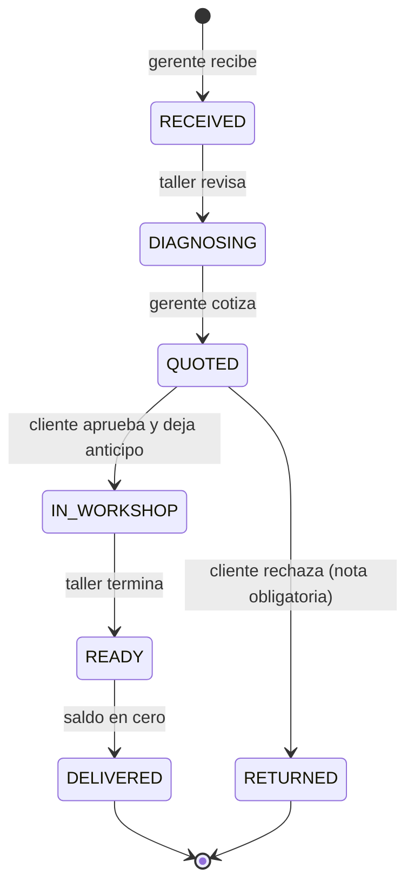
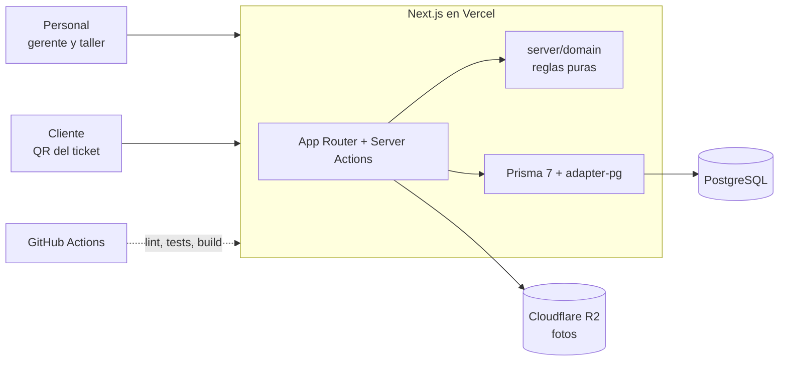

# Taller Bottega

Sistema de órdenes de reparación para un taller de restauración de bolsos y zapatos en León, Guanajuato. Registra cada pieza desde que entra hasta que se entrega, y el cliente consulta el estado con el QR de su ticket, sin crear cuenta.

> Proyecto real en construcción para la apertura del taller en diciembre de 2026. Los datos de este repo son ficticios.

## Qué resuelve

- **Recepción:** cliente, piezas, fotos de entrada.
- **Diagnóstico y cotización:** catálogo de servicios, anticipo y fecha compromiso calculada.
- **Seguimiento:** estados con historial de quién hizo cada cambio y cuándo.
- **Consulta pública:** página por token aleatorio que nunca muestra datos personales.
- **Panel:** órdenes por estado y vencidas.

## Flujo de una orden



## Arquitectura



| Capa | Tecnología |
| --- | --- |
| App | Next.js 16 (App Router, Cache Components), React 19, TypeScript estricto |
| Estilos | Tailwind CSS 4 |
| Datos | PostgreSQL 17, Prisma 7 con driver adapter |
| Auth | Auth.js v5, credenciales y roles `ADMIN`, `MANAGER`, `WORKSHOP` |
| Validación | Zod |
| Pruebas | Vitest (unitarias, cobertura ≥ 90% del dominio), Playwright (e2e en escritorio y móvil) |
| CI | GitHub Actions con PostgreSQL de servicio |

Las decisiones técnicas están en [`docs/adr`](docs/adr).

## Correr en local

Requisitos: Node 22, pnpm 10 y Docker.

```bash
cp .env.example .env            # y genera AUTH_SECRET con: npx auth secret
docker compose up -d            # PostgreSQL local
pnpm install
pnpm db:migrate --name init     # solo la primera vez crea la migración inicial
pnpm db:seed                    # usuarios y órdenes de demo
pnpm dev
```

Usuarios de demo (contraseña `demo-bottega`): `admin@demo.local`, `gerente@demo.local`, `taller@demo.local`. El seed imprime los enlaces públicos de cada orden.

## Calidad

```bash
pnpm lint && pnpm typecheck
pnpm test                       # unitarias
pnpm vitest run --coverage      # con umbral de cobertura
pnpm build && pnpm test:e2e     # e2e contra el build de producción
```

## Estructura

```
src/
  app/
    (internal)/panel/   panel del gerente (requiere sesión)
    o/[token]/          página pública de seguimiento
    login/
  server/
    domain/             reglas de negocio puras y probadas
    actions/            Server Actions (escritura en base de datos)
    db.ts
  proxy.ts              protege rutas internas
prisma/                 esquema y seed
tests/unit, tests/e2e
docs/adr/
```

## Hoja de ruta

- [x] Semana 1: base, esquema de datos, auth por roles, reglas de estados, CI
- [ ] Semanas 2–3: recepción, fotos, cotización y cambios de estado en la interfaz
- [ ] Semana 4: ticket con QR
- [ ] Semana 5: panel con tiempos de entrega e ingresos
- [ ] Semana 6: despliegue a producción
- [ ] Después de abrir: avisos por WhatsApp y comisiones de embajadores
